# Coherer 设计文档（设计图）

> 本文所有图使用 **Mermaid** 绘制：GitHub 原生渲染；VS Code 安装 *Markdown Preview Mermaid Support* 插件即可预览。
> 关联文档：[requirements.md](requirements.md)（需求规格） · [architecture.md](architecture.md)（技术选型与协议设计）

## 1. 总体架构图

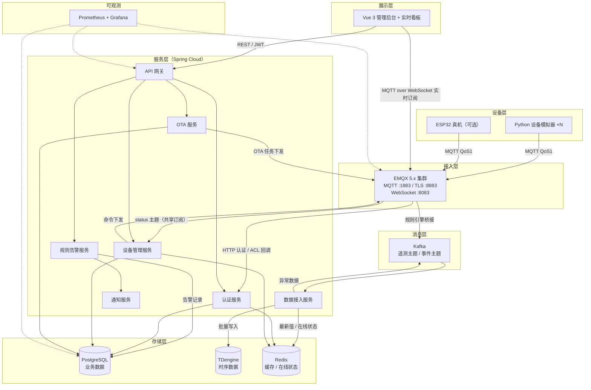

## 2. 功能模块划分

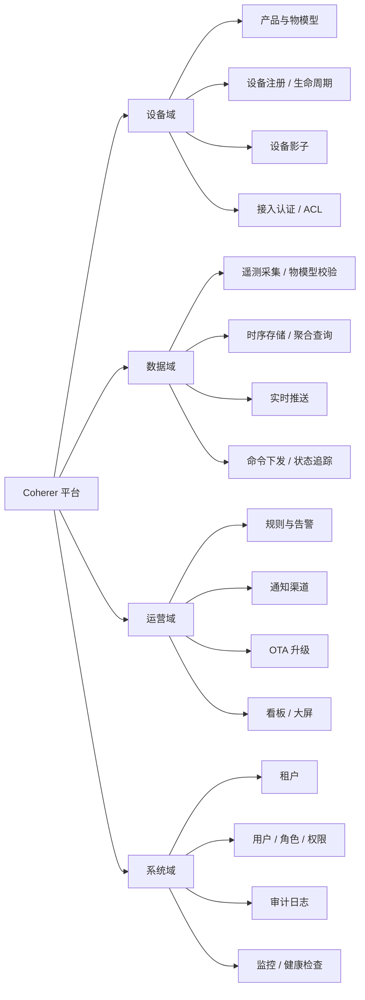

## 3. 核心流程时序图

### 3.1 设备注册（一机一密）

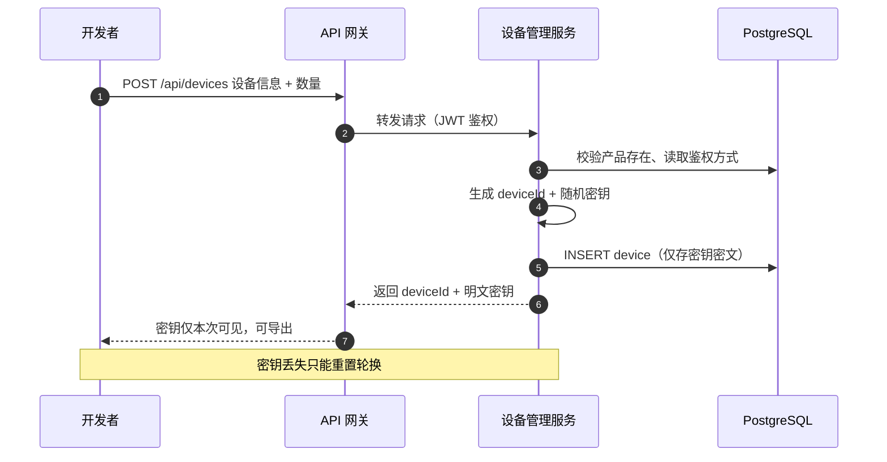

### 3.2 设备连接认证

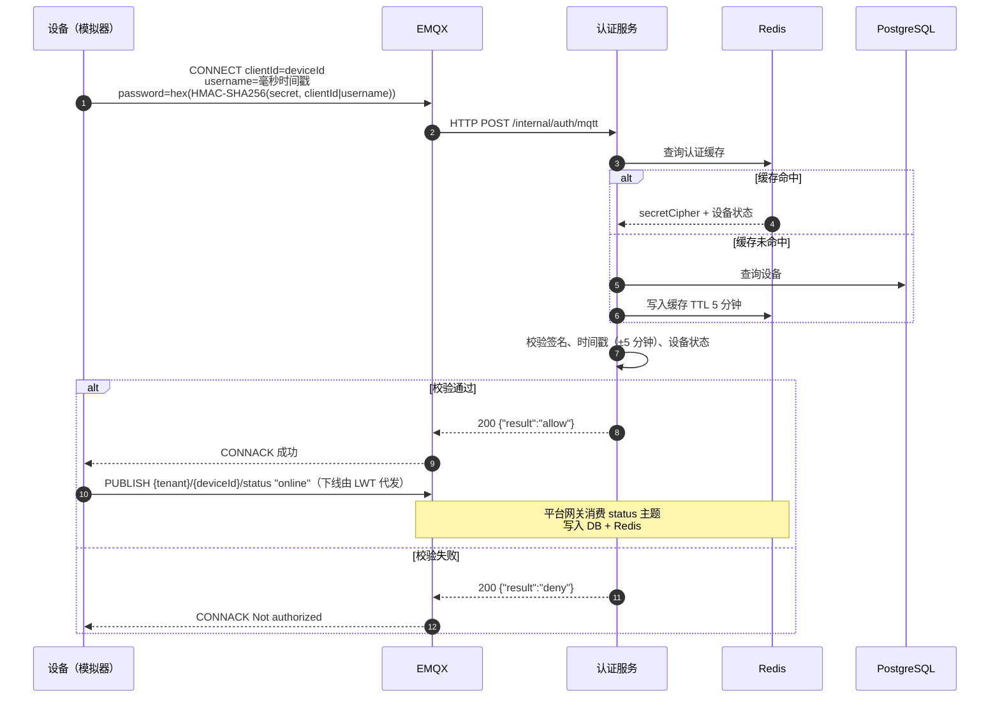

### 3.3 遥测数据链路

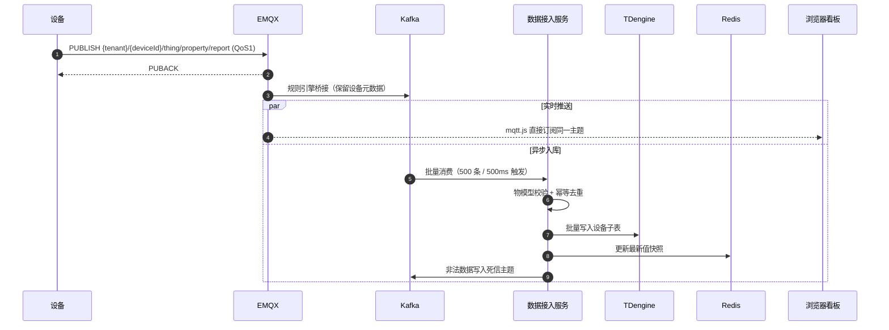

> M2 实现说明：后端通过 Paho 共享订阅直接消费 EMQX 遥测（暂无 Kafka）；Kafka 桥接在 M3 引入，上下游链路不变。

### 3.4 命令下发

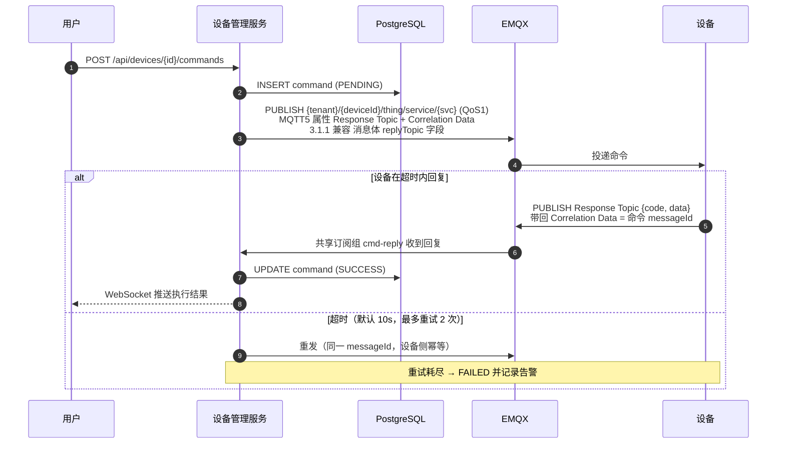

### 3.5 告警处理

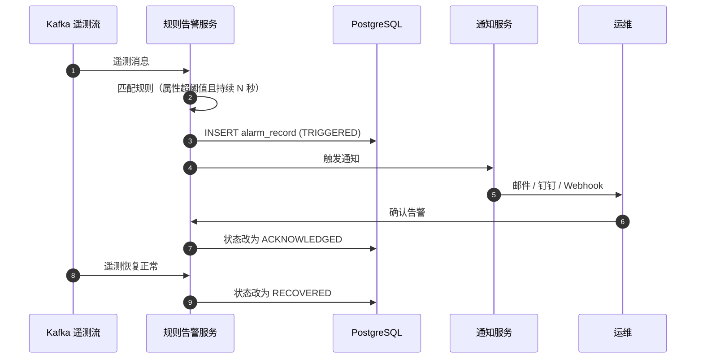

### 3.6 OTA 升级

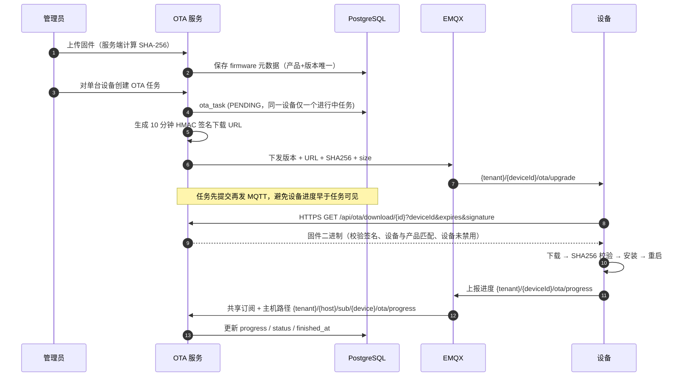

> 当前实现为单设备任务；分组/全量/灰度分批、暂停与回滚作为后续迭代。主机下的设备由平台把
> 指令发到 `{tenant}/{hostId}/sub/{deviceId}/ota/upgrade`，主机负责转发并代传进度。

## 4. 状态机

### 4.1 设备生命周期

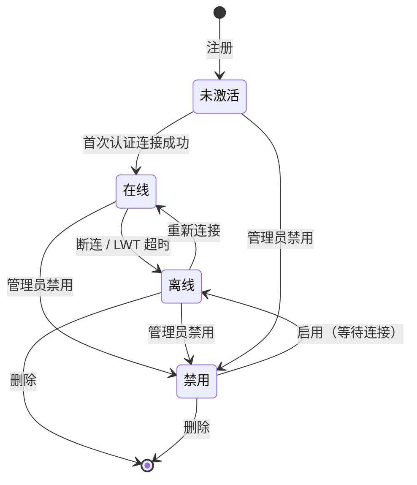

### 4.2 命令状态

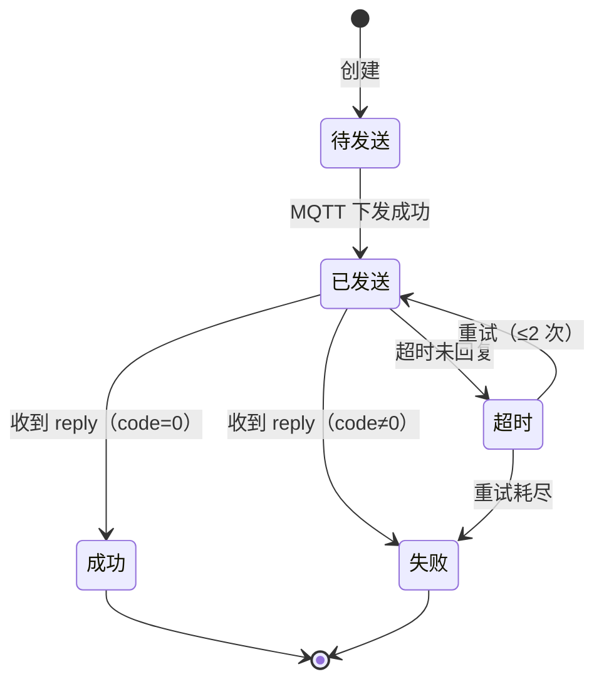

### 4.3 OTA 任务状态

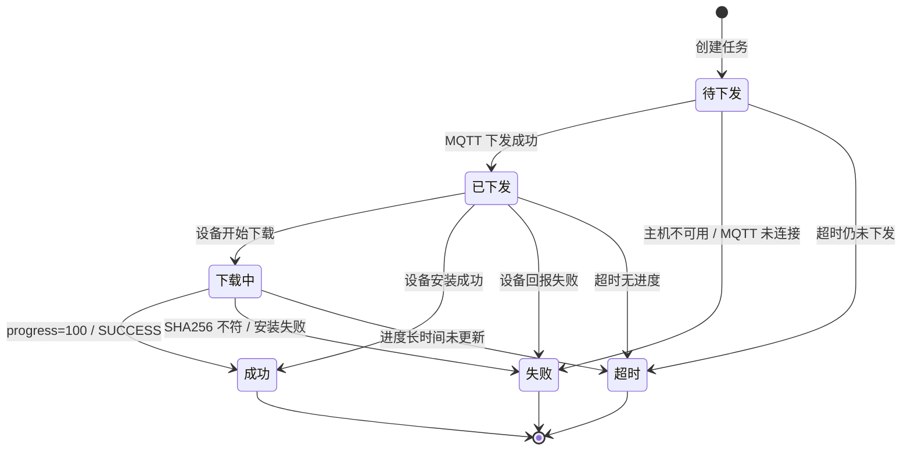

### 4.4 告警状态

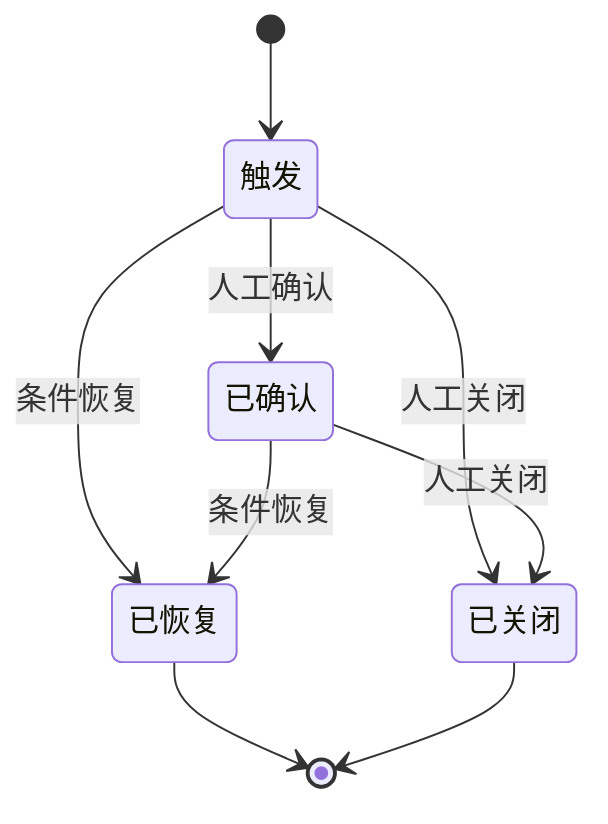

## 5. 数据模型

### 5.1 业务库 ER 图（PostgreSQL）

> 物模型与配置类字段用 `jsonb` 存储；`*_hash` 字段只存哈希不存明文；时序数据不入 PG（M1 阶段使用临时表）。

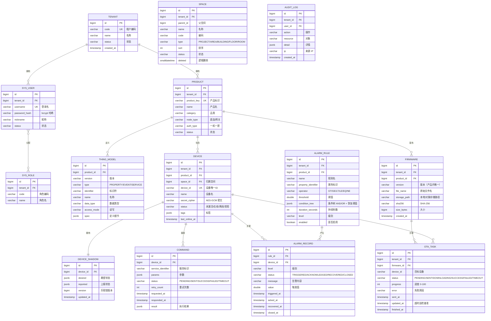

### 5.2 时序模型（TDengine）

M2 通用模型：超级表 `stb_telemetry` + 每设备子表，`payload` 存物模型参数 JSON（M3 按属性生成列式超级表，优化压缩与查询）：

```sql
CREATE STABLE IF NOT EXISTS coherer.stb_telemetry (
    ts      TIMESTAMP,
    payload NCHAR(2048)          -- 物模型参数 JSON
) TAGS (
    device_id  NCHAR(64),
    tenant_id  NCHAR(32),
    product_id BIGINT
);

-- 首次写入自动建子表
INSERT INTO coherer.d_dev_0001 USING coherer.stb_telemetry
TAGS ('dev-0001', 'default', 1234567890) (ts, payload)
VALUES (1730000000000, '{"temperature":23.5,"humidity":55.0}');
```

| 项目 | 规则 |
|---|---|
| 超级表 | `stb_telemetry`（M3 演进为按产品属性的列式超级表） |
| 子表命名 | `d_{deviceId}`（非标识符字符替换为下划线） |
| 标签 | `device_id`、`tenant_id`、`product_id` |
| 数据保留 | 原始数据 90 天（可配置），聚合结果长期 |
| 写入方式 | 物模型校验通过后写入；M3 改为消费端批量写入 |

### 5.3 Redis 键设计

| 键模式 | 类型 | TTL | 用途 |
|---|---|---|---|
| `coherer:auth:device:{deviceId}` | String(JSON) | 5 min | 设备认证缓存（secretCipher/状态） |
| `coherer:status:device:{deviceId}` | String | 无 | 在线状态 `1`/`0`，上下线事件维护 |
| `coherer:latest:device:{deviceId}` | Hash | 24 h | 最新遥测快照（属性→值） |
| `coherer:cmd:{commandId}` | String | 命令超时 + 5 min | 命令状态缓存，避免回调丢失 |
| `coherer:token:refresh:{userId}` | String | 7 d | 刷新令牌白名单 |
| `coherer:dedup:device:{deviceId}` | String | 10 min | 消息幂等去重窗口 |

## 6. 接口设计

### 6.1 对外 REST API（概览）

| 模块 | 方法与路径 | 说明 |
|---|---|---|
| 认证 | `POST /api/auth/login` | 登录，返回 access + refresh token |
| 认证 | `POST /api/auth/refresh` | 刷新令牌 |
| 实时 | `GET /api/mqtt/credentials` | 浏览器短时 MQTT 凭证（WebSocket 直连 EMQX） |
| 产品 | `GET/POST /api/products` | 产品列表 / 创建 |
| 产品 | `GET/PUT/DELETE /api/products/{id}` | 产品详情 / 修改 / 删除 |
| 物模型 | `GET/PUT /api/products/{id}/thing-model` | 查询 / 保存物模型定义 |
| 空间 | `GET /api/spaces/tree` | 空间树（项目/区域/楼栋/楼层/房间） |
| 空间 | `POST /api/spaces` · `PUT/DELETE /api/spaces/{id}` | 创建 / 修改 / 删除空间 |
| 设备 | `GET/POST /api/devices` | 设备列表（分页/筛选/空间）/ 注册（支持批量） |
| 设备 | `GET/PUT/DELETE /api/devices/{id}` | 详情 / 修改 / 删除 |
| 设备 | `POST /api/devices/{id}/enable` | 启用 |
| 设备 | `POST /api/devices/{id}/disable` | 禁用 |
| 影子 | `GET/PUT /api/devices/{id}/shadow` | 查询影子 / 设置 desired |
| 遥测 | `GET /api/devices/{id}/telemetry` | 历史查询（时间范围 + 聚合粒度） |
| 命令 | `POST /api/devices/{id}/commands` | 服务调用 |
| 命令 | `GET /api/devices/{id}/commands` | 命令历史 |
| 告警 | `GET /api/alarms` | 告警列表（筛选） |
| 看板 | `GET /api/dashboard/overview` · `/telemetry-trend` · `/recent-telemetry` | 总览 KPI、小时趋势、全平台最近遥测 |
| 告警 | `POST /api/alarms/{id}/ack` `.../close` | 确认 / 关闭 |
| 规则 | `GET/POST /api/alarm-rules` | 告警规则管理 |
| OTA | `GET/POST /api/ota/firmwares` · `DELETE /api/ota/firmwares/{id}` | 按产品列出 / 上传（multipart）/ 删除固件 |
| OTA | `GET /api/ota/download/{firmwareId}` | 设备侧签名下载（无需 JWT，10 分钟有效） |
| OTA | `POST /api/ota/tasks` | 对单设备创建升级任务并立即下发 |
| OTA | `GET /api/ota/tasks?deviceId=&limit=` | 设备最近升级任务与进度 |

### 6.2 内部接口（EMQX 回调）

| 方法与路径 | 调用方 | 说明 |
|---|---|---|
| `POST /internal/auth/mqtt` | EMQX HTTP 认证器 | 设备连接/发布/订阅认证，返回 allow/deny |
| `POST /internal/auth/acl` | EMQX HTTP ACL | 主题级权限校验 |
| `POST /internal/events/connected` | EMQX Webhook | 设备上线事件 |
| `POST /internal/events/disconnected` | EMQX Webhook | 设备下线事件（含 LWT 原因） |

### 6.3 MQTT 主题与消息格式

主题规划详见 [architecture.md](architecture.md) 第 3 节。消息体统一信封：

**属性上报**（`{tenant}/{deviceId}/thing/property/report`）

```json
{
  "id": "msg-000123",
  "ts": 1762953600000,
  "version": "1.0",
  "params": {
    "temperature": 23.5,
    "humidity": 55.0
  }
}
```

**命令下发**（`{tenant}/{deviceId}/thing/service/{serviceIdentifier}`）

MQTT 5.0 设备使用原生属性：

| MQTT 5 属性 | 值 | 说明 |
|---|---|---|
| Response Topic | `{tenant}/{deviceId}/thing/service/{svc}/reply` | 设备回复地址 |
| Correlation Data | `cmd-8842` | 命令 messageId，设备回复时原样带回 |
| Message Expiry Interval | 10 秒 | 超时后 Broker 不再投递（即命令有效期） |

Payload（两种协议版本共用）：

```json
{
  "id": "cmd-8842",
  "ts": 1762953600000,
  "service": "reboot",
  "params": { "delaySeconds": 5 },
  "replyTopic": "default/dev-0001/thing/service/reboot/reply"
}
```

**协议兼容策略**

| 设备能力 | 下发方式 | 回复方式 | 关联依据 |
|---|---|---|---|
| MQTT 5.0 | 设置 Response Topic + Correlation Data 属性 | 发布到 Response Topic，带回 Correlation Data | MQTT 5 属性（推荐） |
| MQTT 3.1.1 | 读取消息体 `replyTopic` 字段 | 发布到 `replyTopic`，`id` 原样带回 | messageId 字段 |

平台侧统一按 messageId 关联命令与回复；重试时 messageId 不变，设备侧必须幂等执行。

**命令回复**（Response Topic 或 `replyTopic`）

```json
{
  "id": "cmd-8842",
  "code": 0,
  "message": "ok",
  "data": {}
}
```

## 7. 部署架构

### 7.1 开发环境（Docker Compose + 本机进程）

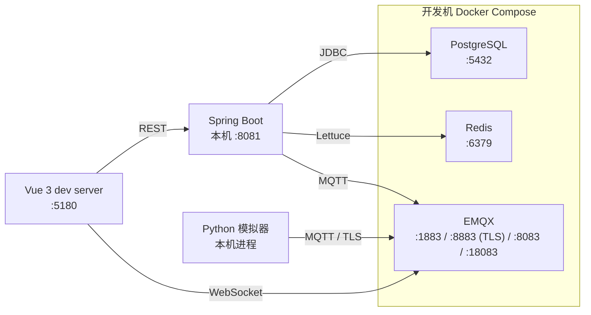

### 7.2 生产环境（Kubernetes）

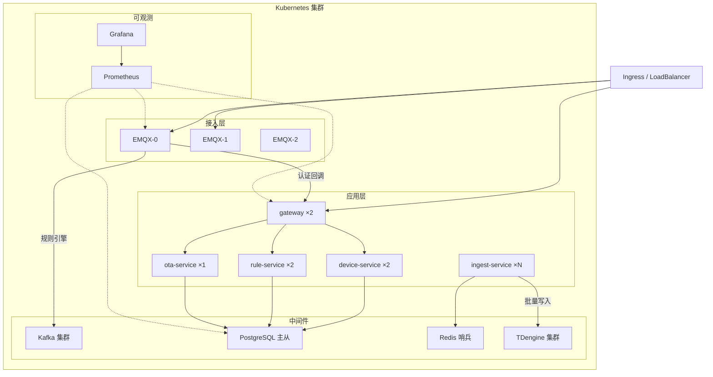

## 8. 关键设计决策

| 决策 | 结论 | 理由 |
|---|---|---|
| 接入协议 | MQTT 3.1.1/5.0，JSON 载荷起步 | 生态成熟；后续按需演进 Protobuf |
| 认证方式 | HMAC-SHA256 签名 + HTTP 认证回调 | 对齐阿里云 IoT；密钥不落明文；可缓存 |
| MQTT 消费模型 | 共享订阅 `$share/coherer/...` | 消费者水平扩展、无重复消费（同组内） |
| 削峰 | Kafka 桥接遥测流 | 入库解耦、可重放、多消费组复用 |
| 时序模型 | M2：通用超级表 + 每设备子表（payload JSON）；M3：按物模型属性生成列式超级表 | 先打通链路，再按物模型优化压缩与查询性能 |
| 设备影子 | desired/reported/version 乐观锁 | 解决离线设备命令问题；面试常考 |
| 命令可靠性 | QoS1 + messageId 幂等 + reply + 超时重试；MQTT 5 优先 Response Topic / Correlation Data，3.1.1 回退 replyTopic 字段 | 兼顾语义与成本，不做 QoS2；新旧协议双兼容 |
| 前端实时数据 | 浏览器 mqtt.js 直连 EMQX WS | 实时性最好，避免后端转发瓶颈 |
| 鉴权 | JWT（access+refresh）+ RBAC | 无状态、便于网关统一校验 |
